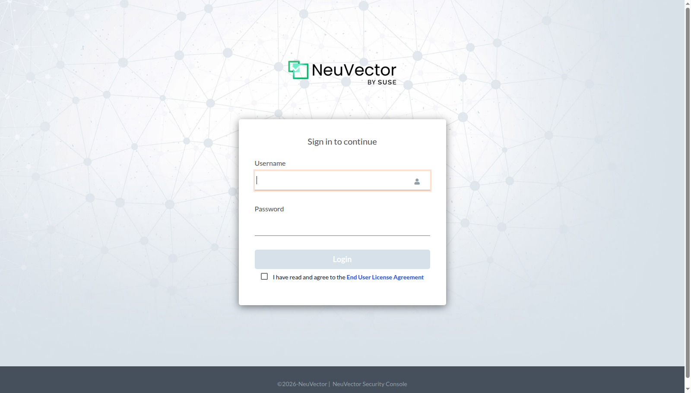
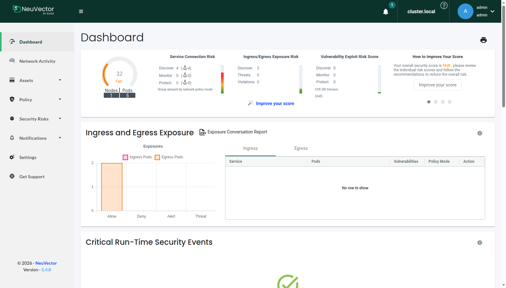
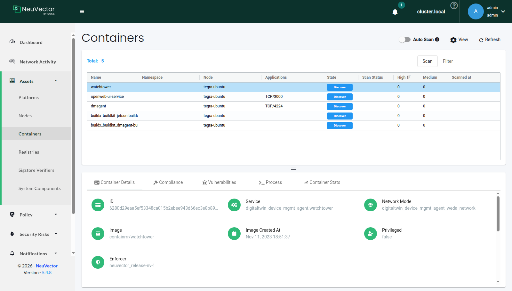
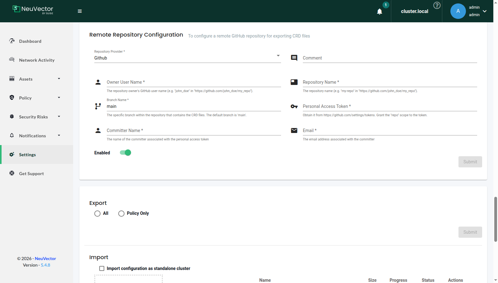
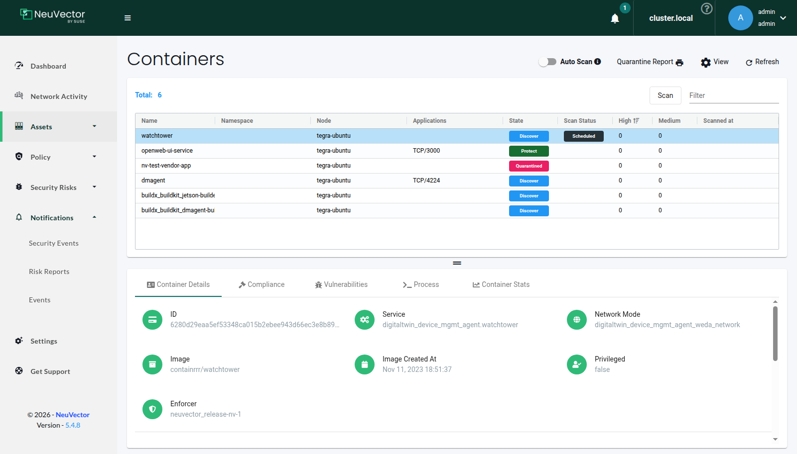

# WEDA Container Runtime Protection — Quickstart

Get NeuVector running on an edge device, through WEDA or directly with Docker, in minutes.

## What This Is

The official, unmodified NeuVector `allinone` image, deployed and verified with this repo's compose file and REST calls. NeuVector is open-source software by SUSE; this project is not affiliated with SUSE — see [NOTICE.md](NOTICE.md).

| Property | Value |
|----------|-------|
| Image | `docker.io/neuvector/allinone:5.4.8` (upstream, unmodified) |
| Image size | ~1.1 GB unpacked, ~430 MB download (amd64 and arm64) |
| Web UI | Yes (port 8443) |
| REST API | Yes (port 10443) |

Runs as a single all-in-one container (controller + enforcer + manager) on Docker. No Kubernetes needed. The Web UI and REST API use NeuVector's own self-signed certificates — there's no separate cert-generation step, and no deploy/test scripts to run.

This guide has three parts:

1. **[NeuVector Deployment](#1-neuvector-deployment)** — get the container running and confirm it via API.
2. **[Access NeuVector via UI](#2-access-neuvector-via-ui)** — the everyday way to use it: tunnel in, log in, look around, apply a policy.
3. **[Access NeuVector via API](#3-access-neuvector-via-api-optional)** *(optional)* — the same things as raw REST calls, for scripting or automation.

## Prerequisites

### Machine Requirements

| Requirement | Details |
|-------------|---------|
| OS | Linux — Ubuntu 20.04/22.04 |
| CPU | 2 cores recommended (1 minimum) |
| RAM | 2 GB recommended (1 GB minimum) |
| Disk | 4 GB free recommended (2 GB minimum) |
| Architecture | x86_64, ARM64 |
| Access | `sudo` / root privileges (for local deploy) or a WEDA account with device access (for WEDA deploy) |

### Install Dependencies

```bash
# Ubuntu / Debian
sudo apt-get update && sudo apt-get install -y docker.io docker-compose-v2 curl jq
```

> Having trouble installing Docker? See the [official Docker install guide for Ubuntu](https://docs.docker.com/engine/install/ubuntu/).

Make sure Docker is running:

```bash
sudo systemctl start docker
sudo systemctl enable docker
```

### Clone the Repository

```bash
git clone git@github.com:Advantech-Containers/Advantech-WEDA-Container-Runtime-Protection.git
cd Advantech-WEDA-Container-Runtime-Protection
```

Nothing to `chmod` — there are no scripts to run.

---

## 1. NeuVector Deployment

Pick whichever matches your situation: deploy through WEDA's own API (below), or directly on the device with `docker compose` if you're already on it (see [Deploy Directly](#deploy-directly-already-on-the-device-no-weda) further down). Both end with the same container running; only the deploy mechanism differs.

> **At a glance:** ① Create Stack → ② Deploy Stack → ③ Verify Stack Deployment Result (by API)

### Create Stack

One raw call against WEDA's container-management API, from `docker-compose.yml`:

```bash
DOMAIN="<your-weda-domain>"; TENANT="<your-tenant>"; ORG_ID="<your-org-id>"
DEVICE_ID="<your-device-id>"; TOKEN="<your-weda-jwt>"
BASE="https://${DOMAIN}/${TENANT}/weda"

COMPOSE_B64=$(base64 -w0 docker-compose.yml)
curl -sk -X POST "${BASE}/api/v1/orgs/${ORG_ID}/stack-configs" \
  -H "Authorization: Bearer ${TOKEN}" -H "Content-Type: application/json" \
  -d "{\"stackName\":\"neuvector\",\"type\":\"compose\",\"composeFileContent\":\"${COMPOSE_B64}\"}"
# -> note stackConfigId and stackRevisionId from the response
```

**Expected output** — a JSON object echoing back your stack, plus two IDs you'll need next:

```json
{
  "stackConfigId": "b85bbe2b-...",
  "stackRevisionId": "0cbdaa2a-...",
  "stackName": "neuvector",
  ...
}
```

`DOMAIN`/`TENANT`/`ORG_ID`/`DEVICE_ID`/`TOKEN` come from your WEDA account and org settings, the same way they would for any other WEDA API call.

**Never PATCH-and-deploy on top of an active deployment.** If a stack config with this name already exists, this is a redeploy — undeploy the old revision first (`PATCH` the config for a new revision, `DELETE .../docker/stacks?stackConfigId=<id>` to clear the old deployment record, *then* deploy the new revision), or `dmagent` can receive conflicting instructions and tear down its own freshly-started containers in a loop.

### Deploy Stack

```bash
curl -sk -X POST "${BASE}/api/v1/orgs/${ORG_ID}/stack-configs/<stackConfigId>/revisions/<stackRevisionId>:deploy" \
  -H "Authorization: Bearer ${TOKEN}" -H "Content-Type: application/json" \
  -d "{\"deviceIds\":[\"${DEVICE_ID}\"]}"
```

**Expected output** — this call only registers the request, it doesn't wait for the device;
`status` here is the deployment's own state (`deploying`), not yet the container's:

```json
{
  "stackDeployments": [
    {
      "stackConfigId": "b85bbe2b-...",
      "stackRevisionId": "0cbdaa2a-...",
      "stackName": "neuvector",
      "deviceId": "<your-device-id>",
      "status": "deploying",
      "containers": []
    }
  ],
  "totalDevices": 1,
  "newlyDeployedDevices": 1
}
```

### Verify Stack Deployment Result (by API)

```bash
curl -sk -H "Authorization: Bearer ${TOKEN}" "${BASE}/api/v1/devices/${DEVICE_ID}/docker/stacks"
```

**Expected output** — a list of stacks on the device (under `items`, not `stacks`); find yours
by `stackConfigId` and watch `status`:

```json
{
  "totalCount": 1,
  "items": [
    {
      "stackConfigId": "b85bbe2b-...",
      "stackName": "neuvector",
      "status": "running",
      "containers": [
        {"name": "edge_neuvector-nv-1", "state": "running", "error": null}
      ],
      "error": {}
    }
  ]
}
```

**What happens:** WEDA's `dmagent` on the device pulls the image (if not already local) and starts
the container via `docker compose` under the hood. Poll every 5-10 seconds until `status` reads `running`. This can take anywhere from a few seconds to a couple of minutes depending on device load; `deploying` or `pending` are normal intermediate states, not failures. The `error` field itself stays `{}` even on a genuine failure — confirmed live — the actual error message is in `reason` (and `operationStatus: "error"`), not `error`.

### Deploy Directly (already on the device, no WEDA)

```bash
docker compose up -d
```

**What happens:**
1. The upstream image is pulled from Docker Hub (if not already local).
2. Any existing NeuVector container with the same name is replaced.
3. A new container starts. On first boot it generates the internal controller–enforcer
certificates into `/var/neuvector/certs/internal` (the upstream image ships none), then serves
the Web UI and REST API with NeuVector's self-signed certificates. It keeps its data, including
those certificates, under `/var/neuvector` (survives every future redeploy).

**Verify the container is running:**

```bash
sudo docker compose ps
```

You should see the `nv` service with status `Up` or `running`.

### Wait for Initialization

Both deployment options need the same wait afterward — this is NeuVector's own startup time, unrelated to how it was deployed.

**Wait ~90 seconds** before the Web UI/API are actually reachable.

---

## 2. Access NeuVector via UI

This is the everyday way to use NeuVector — log in, look at what it found, apply a policy — all through the console. If you deployed via WEDA, the container is on a remote device with no direct network route to it, so you'll open a tunnel first.

> **At a glance:** ① Create Tunnel → ② Login → ③ Check Dashboard → ④ Check Assets/Containers → ⑤ Load Example Policy Config → ⑥ Enable Policy for the Selected Containers

### Create Tunnel to NeuVector Web Service

Skip this if you deployed directly with `docker compose` (Option B above) — just use the device's own IP or `localhost` as `HOST` below. If you deployed via WEDA, open a tunnel to port `8443` (the Web UI), not `10443` (that's the REST API's own port — see [Section 3](#3-access-neuvector-via-api-optional) if you want to talk to that instead):

```bash
curl -sk -X POST "${BASE}/api/v1/devices/${DEVICE_ID}/tunnels/sessions" \
  -H "Authorization: Bearer ${TOKEN}" -H "Content-Type: application/json" \
  -d '{"serviceType":"http","applicationHost":"<device-real-ip-or-shared-network-ip>","applicationPort":8443,"purpose":"quickstart-ui","tags":["quickstart"]}'
# -> note tunnelSessionId from the response

# Poll until it's ready
curl -sk -H "Authorization: Bearer ${TOKEN}" \
  "${BASE}/api/v1/devices/${DEVICE_ID}/tunnels/sessions/<tunnelSessionId>"
```

**Expected output** — the poll response includes `sessionStatus` and, once ready, a `tunnelEndpoint`. This is a real one captured live, not a placeholder — note it's a bare `host:port` pair, no `https://` scheme or path:

```json
{
  "sessionStatus": "ESTABLISHED",
  "tunnelEndpoint": "203.0.113.10:11112"
}
```

`tags` must be a **non-empty** array — `tags: []` is rejected outright with a `ValidationError`, confirmed live. `applicationHost` is the single most failure-prone field here — `127.0.0.1`/`localhost` can fail the tunnel's own health check even though the target is genuinely reachable on the device itself; use the device's real LAN IP, or a shared-network IP if the container is on `dmagent`'s own Docker network. A session can also cycle `ESTABLISHED` → `TERMINATED` → `ESTABLISHED` repeatedly with the `tunnelEndpoint` changing each time, and auto-closes after 120s idle with no keep-alive call — do everything you need with it in one sitting. **`tunnelEndpoint`'s port is whatever WEDA assigns for that session (e.g. `11112` above) — it has nothing to do with NeuVector's own `8443`/`10443` listed under [Ports](#ports) below; always use the port the poll response actually gives you, never a hardcoded one.** See [`weda-deploy-skill/REFERENCE.md`](weda-deploy-skill/REFERENCE.md) (Act 2) for the full detail.

### Access NeuVector Web Service via Tunnel

Open a browser to `https://<tunnelEndpoint>` (e.g. `https://203.0.113.10:11112` from the example above — or `https://<device-ip>:8443` if you deployed directly, no tunnel needed).

#### 1. Login

Accept the self-signed certificate warning, then log in with the **default credentials**:

| Field | Value |
|-------|-------|
| Username | `admin` |
| Password | `admin` |

The **Login** button stays disabled until you check **"I have read and agree to the End User License Agreement"** below the password field — a real first-run gotcha, not something you did wrong if it looks unresponsive at first. That agreement is NeuVector's own, between you and its publisher; read it before you accept it:



Change this password immediately after first login — the login response itself flags it (`"default_password": true`) until you do.

#### 2. Check Dashboard

Once logged in, the Dashboard confirms the instance is live — risk score, node/pod counts, and exposure charts all populate within the first minute or so:



#### 3. Check Assets/Containers

**Assets → Containers** shows every *other* container NeuVector has discovered on the host — `watchtower`, `dmagent`, and whatever else is already running there — confirmed live that NeuVector's own container does not list itself here. This is the same data the `/v1/workload` API endpoint returns, just rendered:



#### 4. Load Example Policy Config

NeuVector's own config import/export lives under **Settings → Configuration**, right below the Export controls shown here (this screenshot is the real screen, captured live — Export on top, Import directly below it):



This native Import expects NeuVector's own exported config format (a full or policy-only bundle from that same Export control, or a CRD-style bundle from another cluster) — it's the right tool for copying settings *from another NeuVector instance*, not for the flat [`protect-config-template.example.json`](protect-config-template.example.json) shipped in this repo, which is a different, simpler shape built for the individual REST calls in [Section 3](#3-access-neuvector-via-api-optional) (or the `weda-neuvector-deploy-skill` AI skill — see [README.md#ai-skills](README.md#ai-skills)). To load *that* example policy through the console by hand instead of the API, apply its pieces on their own pages — Protect mode below, then **Policy → Network Rules** and **Policy → Response Rules** for the rest of the template's rules.

#### 5. Enable Policy for the Selected Containers

From **Assets → Containers**, open a container's group and set its policy/profile mode to Protect — the exact control is on the group's own config screen, not something we've screenshotted here (every Protect-mode switch we've verified this session went through the REST calls in [Section 3](#3-access-neuvector-via-api-optional) instead of clicking through the console). Once applied, the group's badge turns green (`Protect`) in the list — a container placed in `Quarantined` (red) is what a response rule like the template's "quarantine on critical event" can trigger automatically:



The equivalent raw calls (`policy_mode`/`profile_mode` → `Protect`) are in [Section 3](#3-access-neuvector-via-api-optional) if you'd rather script this than click through it.

---

## 3. Access NeuVector via API (Optional)

Everything in Section 2 has a raw-REST equivalent — useful for scripting, automation, or if you'd rather not use the console at all. The API is available at `https://<HOST_IP>:10443` (a *different* port from the Web UI's `8443` above — open a separate tunnel session to it if you're going through WEDA, tunnels are per-port).

> **At a glance:** ① Log In and Verify → ② Apply the Security Config Template

### Log In and Verify

```bash
HOST="<device-ip-or-tunnel-endpoint-on-port-10443>"

TOKEN=$(curl -sk -X POST "https://${HOST}:10443/v1/auth" \
  -H "Content-Type: application/json" \
  -d '{"password":{"username":"admin","password":"admin"}}' | jq -r '.token.token')

curl -sk "https://${HOST}:10443/v1/system/summary" -H "X-Auth-Token: ${TOKEN}" | jq .
```

The login call itself returns `200` with a `token.token` field (this is what `jq -r '.token.token'` above extracts):

```json
{
  "token": {
    "token": "eyJhbGciOi...",
    "username": "admin",
    "default_password": true
  }
}
```

A successful, healthy response from `system/summary` looks like:

```json
{
  "summary": {
    "controllers": 1,
    "enforcers": 1,
    "hosts": 1,
    "workloads": 1,
    "platform": "Docker",
    "component_versions": ["v5.4.8"]
  }
}
```

Allow ~30-45 seconds after first boot for `controllers`/`enforcers`/`hosts` to actually populate — seeing `0` immediately after startup isn't a failure, just discovery still catching up. If you changed the default password, use those credentials in the login call instead of `admin`/`admin`.

**Log out when done:**

```bash
curl -sk -X DELETE "https://${HOST}:10443/v1/auth" -H "X-Auth-Token: ${TOKEN}"
```

### Apply the Security Config Template

[`protect-config-template.example.json`](protect-config-template.example.json) (repo root) is a baseline security config: Protect mode, a set of file-monitor rules, an allow-DNS/allow-HTTPS/deny-everything-else network policy, and a response rule that quarantines the container on a critical security event. `weda-neuvector-deploy-skill`'s `template` subcommand applies the whole file in one command (see README.md's [AI Skills](README.md#ai-skills) section) — this is the no-script equivalent, one raw NeuVector REST call per field in the template, for anyone who'd rather not run the skill.

```bash
HOST="<device-ip-or-tunnel-endpoint>"; GROUP="<your-container-group>"   # full name, e.g. nv.edge_myapp.myapp
SERVICE="${GROUP#nv.}"    # same group, "nv." prefix stripped — see the note under step 1
TOKEN="<nv-token>"    # from the login call above
```

**1. `policy_mode` + `profile_mode` → Protect mode**

```bash
curl -sk -X PATCH "https://${HOST}:10443/v1/service/config/network" \
  -H "X-Auth-Token: ${TOKEN}" -H "Content-Type: application/json" \
  -d "{\"config\":{\"services\":[\"${SERVICE}\"],\"policy_mode\":\"Protect\"}}"

curl -sk -X PATCH "https://${HOST}:10443/v1/service/config/profile" \
  -H "X-Auth-Token: ${TOKEN}" -H "Content-Type: application/json" \
  -d "{\"config\":{\"services\":[\"${SERVICE}\"],\"profile_mode\":\"Protect\"}}"
```

Unlike every other field below, this one wants the group's short name — `SERVICE` (`nv.` prefix stripped), not the full `GROUP` name. Mixing them up here is the most common mistake in this section; a request sent with the full `nv.`-prefixed name in `services` silently matches no group instead of erroring.

**Expected output** — both calls return `200` with an empty body; that's normal for this endpoint, not a sign anything failed. Confirm it actually took by re-fetching the group (a `200` PATCH doesn't always mean the very next read reflects it — retry briefly if you still see the old value):

```bash
curl -sk "https://${HOST}:10443/v1/group/${GROUP}" -H "X-Auth-Token: ${TOKEN}" | jq '.group.policy_mode, .group.profile_mode'
```
```
"Protect"
"Protect"
```

This is the same change Section 2's screenshot shows in the console — the group's badge switching to green `Protect`.

**2. `file_monitor_rules` → one call per filter**

```bash
curl -sk -X PATCH "https://${HOST}:10443/v1/file_monitor/${GROUP}" \
  -H "X-Auth-Token: ${TOKEN}" -H "Content-Type: application/json" \
  -d "{\"config\":{\"add_filters\":[{\"filter\":\"/etc/shadow\",\"recursive\":false,\"behavior\":\"block_access\",\"applications\":[],\"group\":\"${GROUP}\"}]}}"
```

Repeat per entry in the template's `file_monitor_rules` array. NeuVector itself dedupes an already-registered filter, so re-running a call for one already applied is a safe no-op.

**Expected output** — this one returns `200` with a body; re-fetching the same endpoint shows the filter registered:

```json
{
  "profile": {
    "group": "nv.edge_myapp.myapp",
    "filters": [
      {
        "filter": "/etc/shadow",
        "recursive": false,
        "behavior": "block_access",
        "applications": [],
        "cfg_type": "user_created",
        "created_timestamp": 1790583878,
        "last_modified_timestamp": 1790583878
      }
    ]
  }
}
```

**3. `network_rules` → one batched `insert` call**

```bash
curl -sk -X PATCH "https://${HOST}:10443/v1/policy/rule" \
  -H "X-Auth-Token: ${TOKEN}" -H "Content-Type: application/json" \
  -d "{\"insert\":{\"after\":0,\"rules\":[
    {\"comment\":\"protect-baseline: allow DNS outbound\",\"from\":\"${GROUP}\",\"to\":\"external\",\"ports\":\"any\",\"applications\":[\"DNS\"],\"action\":\"allow\",\"cfg_type\":\"user_created\"},
    {\"comment\":\"protect-baseline: allow HTTPS outbound\",\"from\":\"${GROUP}\",\"to\":\"external\",\"ports\":\"tcp/443\",\"applications\":[],\"action\":\"allow\",\"cfg_type\":\"user_created\"},
    {\"comment\":\"protect-baseline: deny everything else outbound\",\"from\":\"${GROUP}\",\"to\":\"external\",\"ports\":\"any\",\"applications\":[],\"action\":\"deny\",\"cfg_type\":\"user_created\"}
  ]}}"
```

Order matters — rules are evaluated top to bottom, first match wins, which is why both `allow` rules come before the `deny` rule. `GET /v1/policy/rule` first if you want to check what's already applied before inserting, since (unlike file-monitor filters) this endpoint has no built-in dedup — re-running the same `insert` call creates a second, duplicate set of rules.

**Expected output** — `200` with an empty body. Confirm the 3 rules landed, in order, by re-fetching:

```bash
curl -sk "https://${HOST}:10443/v1/policy/rule" -H "X-Auth-Token: ${TOKEN}" | jq --arg g "$GROUP" '.rules[] | select(.from==$g) | {id, comment, from, to, ports, action}'
```
```json
{"id": 1, "comment": "protect-baseline: allow DNS outbound", "from": "nv.edge_myapp.myapp", "to": "external", "ports": "any", "action": "allow"}
{"id": 2, "comment": "protect-baseline: allow HTTPS outbound", "from": "nv.edge_myapp.myapp", "to": "external", "ports": "tcp/443", "action": "allow"}
{"id": 3, "comment": "protect-baseline: deny everything else outbound", "from": "nv.edge_myapp.myapp", "to": "external", "ports": "any", "action": "deny"}
```

**4. `response_rules` → same `insert` shape, against `/v1/response/rule`**

```bash
curl -sk -X PATCH "https://${HOST}:10443/v1/response/rule" \
  -H "X-Auth-Token: ${TOKEN}" -H "Content-Type: application/json" \
  -d "{\"insert\":{\"after\":0,\"rules\":[
    {\"comment\":\"protect-baseline: quarantine on critical security event\",\"event\":\"security-event\",\"group\":\"${GROUP}\",\"conditions\":[{\"type\":\"level\",\"value\":\"Critical\"}],\"actions\":[\"quarantine\"],\"disable\":false,\"cfg_type\":\"user_created\"}
  ]}}"
```

Same dedup caveat as step 3 — check `GET /v1/response/rule` before re-inserting.

**Expected output** — `200` with an empty body; re-fetching shows the rule registered:

```json
{
  "id": 8,
  "comment": "protect-baseline: quarantine on critical security event",
  "event": "security-event",
  "group": "nv.edge_myapp.myapp",
  "conditions": [{"type": "level", "value": "Critical"}],
  "actions": ["quarantine"],
  "disable": false,
  "cfg_type": "user_created",
  "webhooks": []
}
```

**Verify it took** (never trust a `PATCH`'s `200` alone):

```bash
curl -sk "https://${HOST}:10443/v1/group/${GROUP}" -H "X-Auth-Token: ${TOKEN}" | jq '.group.policy_mode, .group.profile_mode'
curl -sk "https://${HOST}:10443/v1/policy/rule" -H "X-Auth-Token: ${TOKEN}" | jq .
curl -sk "https://${HOST}:10443/v1/response/rule" -H "X-Auth-Token: ${TOKEN}" | jq .
```

See [`weda-neuvector-deploy-skill/REFERENCE.md`](weda-neuvector-deploy-skill/REFERENCE.md) (E2E-2.1–2.4) for the full write-up of these same calls, including the gotchas that shaped them (the exact `insert`/`cfg_type` shape, the group-name-prefix distinction, and the dedup behavior of each endpoint).

### Key API Endpoints

| Endpoint | Method | Purpose |
|----------|--------|---------|
| `/v1/auth` | POST | Login (get token) |
| `/v1/auth` | PATCH | Keep session alive |
| `/v1/auth` | DELETE | Logout |
| `/v1/eula` | GET | EULA status |
| `/v1/system/summary` | GET | Platform and version info |
| `/v1/system/config` | GET | System configuration |
| `/v1/controller` | GET | Controller status |
| `/v1/enforcer` | GET | Enforcer status |
| `/v1/host` | GET | Detected hosts — also carries `docker_bench_status` (CIS Benchmark scan state) |
| `/v1/workload` | GET | Detected containers |
| `/v1/group` | GET | Security groups |
| `/v1/policy/rule` | GET | Network policy rules |
| `/v1/service` | GET | Detected services |
| `/v1/log/event` | GET | Event logs |
| `/v1/log/threat` | GET | Threat logs |
| `/v1/log/violation` | GET | Violation logs |
| `/v1/log/incident` | GET | Incident logs — real enforcement/violation events, e.g. `Container.FileAccess.Violation` |
| `/v1/compliance/asset` | GET | CIS Benchmark / compliance findings — confirmed working on NeuVector 5.4.8 (see README.md's platform reference) |
| `/v1/scan/scanner` | GET | Scanner status — reports `scanners: 0` (the separate `neuvector/scanner` container is not deployed) |

---

## Ports

These are the ports NeuVector itself listens on — accurate when you're on the device directly (Option B, no tunnel). If you deployed via WEDA and are going through a tunnel, the port you actually connect to is whatever `tunnelEndpoint` gives you for that session (e.g. `11112`), never these two directly — see [Create Tunnel to NeuVector Web Service](#create-tunnel-to-neuvector-web-service) above.

| Port | Protocol | Purpose |
|------|----------|---------|
| 8443 | HTTPS | Web UI |
| 10443 | HTTPS | REST API |

---

## Operations

### Stop

```bash
sudo docker compose down
```

### Restart

```bash
sudo docker compose restart
```

### View Logs

```bash
sudo docker compose logs -f
```

### Backup Data

```bash
sudo tar -czvf neuvector-backup.tar.gz /var/neuvector
```

### Restore Data

```bash
sudo docker compose down
sudo rm -rf /var/neuvector
sudo tar -xzvf neuvector-backup.tar.gz -C /
sudo docker compose up -d
```

### Alternative: Export Config from the Console

The `tar` backup above covers everything under `/var/neuvector`. NeuVector also has its own built-in export, under **Settings → Configuration → Export** (or `GET /v1/file/config?section=all`) — a smaller, portable archive of just the policy/user/config sections, useful for copying settings to a different instance rather than restoring this exact one. See the [Load Example Policy Config](#4-load-example-policy-config) screenshot above — Export and Import sit on the same screen.

---

## Cleanup

```bash
# Stop the container
sudo docker compose down

# Remove persistent data
sudo rm -rf /var/neuvector /var/neuvector.backup

# Remove the image
sudo docker rmi docker.io/neuvector/allinone:5.4.8
```

If deployed via WEDA, also remove the stack from the device:

```bash
curl -sk -X DELETE "${BASE}/api/v1/devices/${DEVICE_ID}/docker/stacks?stackConfigId=<stackConfigId>" \
  -H "Authorization: Bearer ${TOKEN}"
```

---

## File Layout

```
Advantech-WEDA-Container-Runtime-Protection/
├── docker-compose.yml     # Container deployment config
├── protect-config-template.example.json  # Baseline security config (see above)
├── README.md              # Full documentation
├── Quickstart.md          # This file
├── NeuVector-User-Guide.md # Manual vs AI-skill install decision guide
├── RELEASE_NOTES.md       # Version history and release details
├── LICENSE              # MIT (this repo's own content)
├── NOTICE.md              # NeuVector licensing and trademark notice
├── weda-deploy-skill/     # AI-agent skill: generic WEDA compose deploy + verify
└── weda-neuvector-deploy-skill/  # AI-agent skill: NeuVector-specific deploy + configure + verify
```

---

## Troubleshooting

### Container won't start

```bash
sudo docker compose logs                                      # Check container logs
sudo docker images                                             # Verify the image exists
```

### API returns errors or times out

The NeuVector controller needs time to initialize. Wait 60-90 seconds after deployment. If the API still doesn't respond:

```bash
sudo docker compose ps            # Is the container still running?
sudo docker compose logs | tail   # Any crash or error messages?
```

> See the [NeuVector REST API documentation](https://open-docs.neuvector.com/automation/automation) for expected responses and error codes.

### Authentication fails

Double-check you're posting the right credentials to `/v1/auth`:

```bash
curl -sk -X POST "https://${HOST}:10443/v1/auth" \
  -H "Content-Type: application/json" \
  -d '{"password":{"username":"admin","password":"admin"}}'
```

A `200` with a `token.token` field means credentials are correct; a `401` means they aren't.

### "Image not found" on deploy

Verify the device can reach Docker Hub:

```bash
docker pull docker.io/neuvector/allinone:5.4.8
```

### WEDA deploy stuck in "deploying" or "pending"

This is usually the device's own agent catching up, not a failure — keep polling `GET /api/v1/devices/{deviceId}/docker/stacks` every 10-15 seconds. If it's still not `running` after several minutes, check the stack's `error` field in that same response for a specific cause.

### Docker daemon issues

```bash
sudo systemctl status docker      # Check if Docker is running
sudo journalctl -u docker -n 50   # View Docker daemon logs
```

> See [Docker daemon troubleshooting](https://docs.docker.com/engine/daemon/troubleshoot/).

---

## References

| Topic | Link |
|-------|------|
| Docker install (Ubuntu) | https://docs.docker.com/engine/install/ubuntu/ |
| Docker Compose reference | https://docs.docker.com/compose/compose-file/ |
| Docker troubleshooting | https://docs.docker.com/engine/daemon/troubleshoot/ |
| NeuVector documentation | https://open-docs.neuvector.com/ |
| NeuVector REST API | https://open-docs.neuvector.com/automation/automation |
| NeuVector GitHub | https://github.com/neuvector/neuvector |
