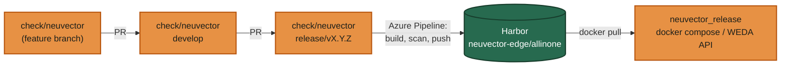

# NeuVector Edge — Release Notes

## Release Pipeline

Starting with `v1.1.1`, the image is built and pushed by an Azure Pipeline in the `check/neuvector` repo (`azure-pipelines.yml`), not by running `minimize.sh` manually and pushing by hand. `neuvector_release` (this repo) never builds or pushes the image — it only ever pulls the already-published result and deploys/tests/scans it.



The pipeline builds **both** variants (minimal/edge and headless) for **both** architectures (AMD64 and ARM64), pushes each to Harbor under `neuvector-edge/allinone`, then runs a Trivy vulnerability scan and generates SPDX + CycloneDX SBOMs for each. It only triggers automatically on `main` or `release/*` — feature and `develop` branches are validated by running it manually first.

---

## Known Issues

### Custom file-monitor filters don't block (or alert) — NeuVector 5.4.3–5.4.9, confirmed 5.4.8

**Since:** first confirmed 2026-09-30, on `v5.4.8.edge.v1.1.2.32309` and earlier. **Status:** open, unresolved as of the 5.5.4 release notes checked. **Track this:** re-verify against any future base-image version bump (see "How to re-verify" below) — do not assume it's fixed without checking.

A `file_monitor` filter registered on a custom, user-created path (`cfg_type: "user_created"`) — the exact mechanism `protect-config-template.example.json`'s `file_monitor_rules` and `weda-neuvector-deploy-skill`'s E2E-3.4 test depend on — does not block access, and does not even log an incident, in Protect *or* Monitor mode, regardless of correct configuration. Confirmed via direct API introspection (group in Protect mode, filter correctly registered with `behavior: "block_access"`) and via `E2E-3.3b` (a sanity check added specifically to isolate this): NeuVector's own predefined sensitive files (e.g. `/etc/passwd`) are still correctly monitored and logged on the same device, same build — so the underlying file-access pipeline works in general; custom filters specifically do not fire.

This matches a bug independently reported on unrelated infrastructure (Kubernetes/containerd, not this project's Docker/edge setup): [SUSE forum, "File monitoring in Neuvector versions 5.4.1, 5.4.2, 5.4.3, 5.4.8 and 5.4.9 doesn't work"](https://forums.suse.com/t/file-monitoring-in-neuvector-versions-5-4-1-5-4-2-5-4-3-5-4-8-and-5-4-9-doesnt-work/46192), tracing to a monitoring-method change introduced in 5.4.3. This is an upstream NeuVector defect, not something fixable in this repo's scripts or config.

**Impact:** the `file_monitor_rules` portion of the bundled security-config template does not provide real enforcement on affected NeuVector versions. `policy_mode`/`profile_mode` (Protect mode itself), `network_rules`, and `response_rules` are unaffected — only custom file-access filters specifically.

**How this is tracked in the test suite:** `weda-neuvector-deploy-skill`'s E2E-3.4 step reports this as informational (not a hard pipeline failure) rather than silently passing, since it's a confirmed external limitation, not a defect in this repo's own code. **This means an automated run will not surface a red/failing status for this on its own** — anyone auditing test output should specifically check E2E-3.4's note in the sign-off report, not just whether the run exited 0. `E2E-3.3b` (pipeline sanity check) and `E2E-3.5` (compliance/CIS-benchmark, an unrelated subsystem) remain genuine, unaffected pass/fail signals in the same run.

**How to re-verify:** bump the base image to a NeuVector version past 5.4.9 (5.5.x or later), then re-run `weda-neuvector-deploy-skill/scripts/run_neuvector.py`'s full flow and check E2E-3.4's result specifically — a `[PASS]` with a real `Operation not permitted` refusal means it's fixed upstream; anything else means it isn't yet.

---

## v5.4.8.edge.v1.1.2.32309

**Release Date:** 2026-09-29
**Base Image:** neuvector/allinone:5.4.8
**Branch:** release/v1.1.2 (`check/neuvector`)
**Tag:** v5.4.8.edge.v1.1.2.32309

---

### Summary

Built via `check/neuvector`'s Azure Pipeline off its `release/v1.1.2` branch — the first release built from the new Dockerfile-based image (PR #7997): `image/Dockerfile` + `image/nv-entrypoint.sh` replace the old `docker run`/export/import build, and TLS certificates are now generated by the image's own entrypoint on first boot rather than a separate `cert-gen.sh` step. This repo (`neuvector_release`) is updated to match: no more `cert-gen.sh`/`deploy.sh`/`test.sh` — deployment and verification are direct calls against WEDA's or NeuVector's own REST APIs, or `docker compose` directly, documented with real console screenshots in `Quickstart.md`. Image tag continues the branch-derived scheme from `v1.1.2.31948`, now also validated against Docker's tag grammar and correct for both short-form (`release/v1.1.2`) and long-form (`release/v5.4.8.edge.vX.Y.Z`) release branch names.

### Changed

| Component | v1.1.2.31948 | v1.1.2.32309 |
|-----------|--------------|--------------|
| Cert generation | Separate `cert-gen.sh` script, run before deploy | Baked into the image's own entrypoint (`nv-entrypoint.sh`), generated automatically on first boot |
| Deployment | `deploy.sh` / `test.sh` scripts | Raw WEDA REST API calls or `docker compose up -d` directly; AI-agent skills for the WEDA-managed path |
| Image build | `docker run`/export/import based | `docker buildx build` from `image/Dockerfile`, single multi-platform build with SBOM + provenance attestations |
| `docker-compose.yml` | Bind-mounted `./certs/*` files | No cert bind mounts — certs persist under `/var/neuvector` (self-generated) |
| Documentation | Text-only | Real console screenshots added (`docs/images/`) for Web UI access, Protect-mode verification, and config export |

No deployment ports, volumes (other than the removed cert bind mounts), or default credentials changed from `v1.1.2.31948`.

---

## v5.4.8.edge.v1.1.2.31948

**Release Date:** 2026-09-23
**Base Image:** neuvector/allinone:5.4.8
**Branch:** develop (`check/neuvector`)
**Tag:** v5.4.8.edge.v1.1.2.31948

---

### Summary

Built via `check/neuvector`'s Azure Pipeline off its `develop` branch, using the pipeline's new branch-derived tagging scheme (`ci: derive image tag from branch name and build id`): tag is `<imageTagBase>.<branch>.<Build.BuildId>`, so this build's `31948` is that pipeline run's `Build.BuildId`, not a manually chosen number. No functional change to the image itself from `v1.1.1` — verified live: same 992 MB size, same labels, `pathWalker` present and confirmed on the ARM64 build pulled and inspected directly.

### Changed

| Component | v1.1.1 | v1.1.2.31948 |
|-----------|--------|--------|
| Image tag scheme | Static `v5.4.8.edge.v1.1.1`, set manually in the pipeline | Derived automatically from source branch + `Build.BuildId` |
| Image content | pathWalker retained | Unchanged — pathWalker retained, confirmed on ARM64 |

No deployment steps, ports, volumes, or environment variables changed from `v1.1.1`. Note: this tag is per-build (bakes in `Build.BuildId`), not a stable pointer — a future pipeline change to also push a static `v1.1.2` tag alongside it is under discussion, so this exact tag string may need updating again once that lands.

---

## v5.4.8.edge.v1.1.1

**Release Date:** 2026-09-22
**Base Image:** neuvector/allinone:5.4.8
**Branch:** release/v5.4.8.edge.v1.1.1
**Tag:** v5.4.8.edge.v1.1.1

---

### Summary

Switches the image build from a manual, locally-run `minimize.sh` process to the `check/neuvector` repo's Azure Pipeline (multi-arch build for AMD64 and ARM64, Trivy scan, SBOM generation), and adds the two automated AI-agent E2E test skills to this repo alongside the manual install path. No functional change to the image itself from `v1.1.0` — `pathWalker` remains retained, confirmed present and working on both AMD64 and ARM64 builds.

### Added

- `weda-deploy-skill` and `weda-neuvector-deploy-skill` — self-contained AI-agent skills that deploy, configure, and verify NeuVector end-to-end via the WEDA platform. See [README.md](README.md#ai-skills) for usage.
- README sections: **Evidence / Response** (live proof the manual install steps actually work), **Release via Pipeline** (the new pipeline-based build process), and an expanded **Test Report** with a Mermaid sequence diagram and per-case Act/Evidence detail.

### Changed

| Component | v1.1.0 | v1.1.1 |
|-----------|--------|--------|
| Image build process | Manual `minimize.sh` run, pushed by hand | Built and pushed by `check/neuvector`'s Azure Pipeline (`azure-pipelines.yml`) |
| Image content | pathWalker retained | Unchanged — pathWalker retained, confirmed on both AMD64 and ARM64 |

No deployment steps, ports, volumes, or environment variables changed from `v1.1.0`.

---

## v5.4.8.edge.v1.1.0

**Release Date:** 2026-09-17
**Base Image:** neuvector/allinone:5.4.8
**Branch:** release/v5.4.8.edge.v1.1.0
**Tag:** v5.4.8.edge.v1.1.0

---

### Summary

Fixes a file-monitor enforcement gap in `v1.0.0`: `pathWalker` is no longer removed during image optimization. File-access rules (`block_access`) registered correctly in `v1.0.0` but never actually blocked reads/writes, because `pathWalker` is the component NeuVector uses to enforce them — the policy engine and console showed the rule as active, but nothing stopped a blocked file from being read. This was confirmed as a build-time defect, not a Docker storage-driver limitation (NeuVector's own docs identify an AUFS-specific block-mode limitation; this image and its target hosts use `overlay2`, so that doesn't apply).

Image size increases by approximately 27 MB relative to `v1.0.0` (964 MB → 992 MB) as a result.

### Changed

| Component | v1.0.0 | v1.1.0 |
|-----------|--------|--------|
| Path Walker (`/usr/local/bin/pathWalker`) | Removed | **Retained** — required for file-access rule enforcement |

No other components, ports, volumes, or deployment steps changed from `v1.0.0`.

---

## v5.4.8.edge.v1.0.0

**Release Date:** 2026-03-13
**Base Image:** neuvector/allinone:5.4.8
**Branch:** release/v5.4.8.edge.v1.0.0
**Tag:** v5.4.8.edge.v1.0.0

---

## Summary

Initial release of the NeuVector Edge container. This is a size-optimized build of the NeuVector allinone image purpose-built for edge and resource-constrained environments. Retains full Web UI and REST API functionality while reducing image size by approximately 200 MB.

> **This entire v1.0.0 section, including everything below it (New Features, Automated Deployment, Comprehensive Test Suite, Quick Start, File Manifest, Test Plan), describes the *original* v1.0.0 architecture as it shipped then — kept here as history, not as the current process. `cert-gen.sh`, `deploy.sh`, and `test.sh` were all removed in `v1.1.2.32309` (see that entry above): certs now generate automatically on first boot, and deployment/verification are direct WEDA/NeuVector REST API calls or `docker compose` directly. **For the current process, see [Quickstart.md](Quickstart.md)** — don't follow the script names below.

---

## Image Details

| Property | Value |
|----------|-------|
| Image Tag | `v5.4.8.edge.v1.0.0` |
| Base Image | `neuvector/allinone:5.4.8` |
| Architecture | x86_64, ARM64 |
| Web UI | Included (port 8443) |
| REST API | Included (port 10443) |
| Labels | `neuvector.role=controller+enforcer+manager` |

---

## New Features

### Optimized Container Image

- Retains Web UI, REST API, controller, and enforcer functionality.
- Removes upgrader, OPA engine, pathWalker, yq, documentation, and man pages.
- Approximately 200 MB smaller than the upstream `neuvector/allinone:5.4.8`.

### TLS Certificate Generation

- One-step TLS certificate generation via `cert-gen.sh`.
- Generates CA certificate, server certificate, and private key.
- Certificates include Subject Alternative Names (SANs): `Neuvector`, `neuvector`, `localhost`, `nv`, `127.0.0.1`.
- 10-year validity (3650 days), 2048-bit RSA keys.
- Proper file permissions enforced (644 for certificates, 600 for private keys).
- Idempotent: skips generation if certificates already exist.

### Automated Deployment

*(`deploy.sh` — removed in `v1.1.2.32309`; see the historical-scope note at the top of this v1.0.0 section)*

- `deploy.sh` handles the complete deployment lifecycle:
  - Pre-flight checks for required image and TLS certificates.
  - Graceful shutdown of existing deployments.
  - Automatic backup of existing `/var/neuvector` data to `/var/neuvector.backup`.
  - Docker Compose-based container startup.
  - Post-start container status verification.

### Comprehensive Test Suite

*(`test.sh` — removed in `v1.1.2.32309`; see the historical-scope note at the top of this v1.0.0 section)*

- `test.sh` with 9 test sections and 20+ individual checks:
  - Container and image validation
  - Port connectivity verification
  - REST API authentication (login, token validation, session keep-alive)
  - System configuration checks (EULA, platform, service policy mode)
  - Controller and enforcer connectivity
  - Host and workload discovery
  - Security features (groups, policy rules, services)
  - Logging endpoints (events, threats, violations)
  - Scanner availability
- Per-test PASS/FAIL/SKIP reporting with cumulative summary.
- Configurable credentials via `NV_USER` and `NV_PASS` environment variables.

---

## Components Removed

| Component | Path | Reason |
|-----------|------|--------|
| Upgrader | `/usr/local/bin/upgrader` | Not applicable for single-node edge |
| OPA Engine | `/usr/local/bin/opa` | Open Policy Agent not required for edge |
| yq | `/usr/bin/yq` | YAML processor not used at runtime |
| Documentation | `/usr/share/doc` | Reduces image size |
| Man Pages | `/usr/share/man` | Reduces image size |

## Components Retained

| Component | Purpose |
|-----------|---------|
| Controller | Policy enforcement and cluster management |
| Enforcer | Network monitoring and runtime security |
| Manager (Web UI) | Browser-based management console (port 8443) |
| REST API | Programmatic management and automation (port 10443) |
| Supervisord | Process manager for multi-service container |
| Path Walker (`/usr/local/bin/pathWalker`) | File-path analysis — required for file-access rule (`block_access`) enforcement in Protect mode. Removed in `v1.0.0`; retained from `v1.1.0` onward (see Revision History). |

---

## Deployment Architecture

### Ports

| Port | Protocol | Purpose |
|------|----------|---------|
| 8443 | HTTPS | Web UI |
| 10443 | HTTPS | REST API |

### Volume Mounts

| Host Path | Container Path | Mode | Purpose |
|-----------|----------------|------|---------|
| `/var/run/docker.sock` | `/var/run/docker.sock` | Read-only | Container discovery |
| `/proc` | `/host/proc` | Read-only | Host process monitoring |
| `/sys/fs/cgroup` | `/host/cgroup` | Read-only | Resource monitoring |
| `/var/neuvector` | `/var/neuvector` | Read-write | Persistent data (also holds self-generated certs as of `v1.1.2.32309` — see below) |

**Removed in `v1.1.2.32309`:** the three `certs/*` bind mounts below no longer exist — certs are generated by the image's own entrypoint on first boot and persist under `/var/neuvector` instead. Kept here only as v1.0.0 history:

| Host Path | Container Path | Mode | Purpose |
|-----------|----------------|------|---------|
| `certs/ca.cert` | `/etc/neuvector/certs/internal/ca.cert` | Read-only | TLS CA certificate |
| `certs/cert.key` | `/etc/neuvector/certs/internal/cert.key` | Read-only | TLS private key |
| `certs/cert.pem` | `/etc/neuvector/certs/internal/cert.pem` | Read-only | TLS server certificate |

### Container Requirements

| Requirement | Value | Reason |
|-------------|-------|--------|
| Privileged mode | Required | Kernel access for network monitoring |
| Host PID namespace | Required | Process visibility across host |
| Docker socket access | Required | Container discovery and inspection |

---

## Default Credentials

| Field | Value |
|-------|-------|
| Username | `admin` |
| Password | `admin` |

Override via environment variables: `NV_USER` and `NV_PASS`.

---

## Known Limitations

### Functional

- Single-node deployment only. Multi-node clusters are not supported.
- No built-in vulnerability scanner (removed during image optimization).
- No in-place upgrade path. Redeploy with new image to upgrade.

### Operational

- Container requires privileged mode and host PID namespace.
- All scripts require root or sudo access.

### Compatibility

- Docker deployments only. Kubernetes orchestration is not supported.
- Linux host operating systems only (Windows and macOS are not supported as container hosts).
- x86_64 and ARM64 architectures only.

---

## Quick Start

*(v1.0.0 process shown for history — `cert-gen.sh`/`deploy.sh`/`test.sh` no longer exist as of
`v1.1.2.32309`; see [Quickstart.md](Quickstart.md) for the current one)*

```bash
# 1. Generate TLS certificates (one-time)
./cert-gen.sh

# 2. Deploy
./deploy.sh

# 3. Wait ~90 seconds for initialization

# 4. Verify
./test.sh
```

**Current process:** `docker compose up -d` (certs generate automatically on first boot) or the
WEDA REST API, then verify via WEDA's or NeuVector's own REST calls — no scripts to run. See
[Quickstart.md](Quickstart.md) for detailed step-by-step instructions.

---

## Exit Codes

| Code | Meaning |
|------|---------|
| `0` | Success |
| `1` | General error |
| `2` | Missing dependencies |
| `3` | Missing prerequisites (image, certificates) |
| `4` | REST API error (test script only) |

---

## REST API Endpoints Tested

| Method | Endpoint | Purpose |
|--------|----------|---------|
| POST | `/v1/auth` | Login and obtain authentication token |
| PATCH | `/v1/auth` | Session keep-alive |
| DELETE | `/v1/auth` | Logout and release session |
| GET | `/v1/eula` | EULA acceptance status |
| GET | `/v1/system/summary` | Platform and system information |
| GET | `/v1/system/config` | System configuration |
| GET | `/v1/controller` | Controller connectivity and version |
| GET | `/v1/enforcer` | Enforcer connectivity and version |
| GET | `/v1/host` | Host detection and OS information |
| GET | `/v1/workload` | Container workload discovery |
| GET | `/v1/group` | Security group inventory |
| GET | `/v1/policy/rule` | Network policy rules |
| GET | `/v1/service` | Discovered network services |
| GET | `/v1/log/event` | Event log |
| GET | `/v1/log/threat` | Threat detection log |
| GET | `/v1/log/violation` | Policy violation log |
| GET | `/v1/scan/scanner` | Scanner status and CVE database version |

---

## Test Plan

*(v1.0.0's `test.sh`-based plan — removed in `v1.1.2.32309`; see the historical-scope note at the top of this v1.0.0 section, and `weda-neuvector-deploy-skill/NeuVector-E2E-Test-Scenario.md` for the current live E2E test scenario)*

### Pre-Requisites

1. Linux host (Ubuntu 22.04 recommended) with Docker Engine and Docker Compose v2 installed.
2. Root or sudo access.
3. `jq`, `curl`, and `openssl` installed.

### Test Matrix

| Test ID | Category | Test Case | Steps |
|---------|----------|-----------|-------|
| TC-001 | Deploy | Container starts and stays running | Run `deploy.sh`, verify container status |
| TC-002 | Deploy | Existing data is backed up | Deploy twice, verify `/var/neuvector.backup` exists |
| TC-003 | Deploy | Fails gracefully if certs missing | Remove `certs/`, run `deploy.sh`, verify exit code 3 |
| TC-004 | Network | Web UI port 8443 responds | `curl -sk https://localhost:8443` |
| TC-005 | Network | REST API port 10443 responds | `curl -sk https://localhost:10443/v1/auth` |
| TC-006 | Auth | Login with default credentials succeeds | POST to `/v1/auth` with admin/admin |
| TC-007 | Auth | Login returns valid JWT token | Verify token is non-null and non-empty |
| TC-008 | Auth | Token has admin role | Verify `token.role` is `admin` |
| TC-009 | Auth | Session keep-alive works | PATCH to `/v1/auth` returns 200 |
| TC-010 | Auth | Logout releases session | DELETE to `/v1/auth` |
| TC-011 | System | System summary returns platform info | GET `/v1/system/summary` |
| TC-012 | System | System config returns service policy mode | GET `/v1/system/config` |
| TC-013 | Core | Controller is connected | GET `/v1/controller`, verify `connection_state` |
| TC-014 | Core | Enforcer is connected | GET `/v1/enforcer`, verify `connection_state` |
| TC-015 | Core | Host is detected | GET `/v1/host`, verify count > 0 |
| TC-016 | Core | Workloads are discovered | GET `/v1/workload`, verify count > 0 |
| TC-017 | Security | Security groups are accessible | GET `/v1/group` |
| TC-018 | Security | Policy rules endpoint is accessible | GET `/v1/policy/rule` |
| TC-019 | Security | Services are discovered | GET `/v1/service` |
| TC-020 | Logging | Event log is accessible | GET `/v1/log/event` |
| TC-021 | Logging | Threat log is accessible | GET `/v1/log/threat` |
| TC-022 | Logging | Violation log is accessible | GET `/v1/log/violation` |
| TC-023 | Scanner | Scanner endpoint responds | GET `/v1/scan/scanner` |
| TC-024 | Scripts | All scripts exit with code 2 if dependencies missing | Remove `jq`, run script, verify exit code |
| TC-025 | Scripts | Test suite exit code 0 when all tests pass | Run `test.sh` on healthy deployment |

### Automated Testing

```bash
./test.sh

# With custom credentials
NV_USER=admin NV_PASS=yourpassword ./test.sh
```

---

## File Manifest

*(current as of `v1.1.2.32309` — `deploy.sh`/`cert-gen.sh`/`test.sh` shown in the v1.0.0 Quick Start above no longer exist; see [Quickstart.md's File Layout](Quickstart.md#file-layout) for the full tree including the AI-agent skill directories)*

| File | Description |
|------|-------------|
| `docker-compose.yml` | Container deployment configuration |
| `protect-config-template.example.json` | Baseline security config template |
| `README.md` | Full product documentation |
| `Quickstart.md` | Quick start guide |
| `NeuVector-User-Guide.md` | Manual vs AI-skill install decision guide |
| `RELEASE_NOTES.md` | This file |
| `LICENSE.md` | Apache 2.0 license |
| `weda-deploy-skill/` | AI-agent skill: generic WEDA compose deploy + verify |
| `weda-neuvector-deploy-skill/` | AI-agent skill: NeuVector-specific deploy + configure + verify |

---

## Revision History

| Version | Date | Description |
|---------|------|-------------|
| v5.4.8.edge.v1.1.2.32309 | 2026-09-29 | Cert generation baked into the image entrypoint (no more `cert-gen.sh`); `deploy.sh`/`test.sh` replaced with raw WEDA/NeuVector REST API calls and `docker compose`; image now built via `docker buildx build` from `image/Dockerfile` |
| v5.4.8.edge.v1.1.2.31948 | 2026-09-23 | Built via check/neuvector's develop pipeline with branch-derived tagging (`<tag>.<branch>.<BuildId>`); no image-content change |
| v5.4.8.edge.v1.1.1 | 2026-09-22 | Build via Azure Pipeline instead of manually; add AI-agent E2E skills; expand README (Evidence/Response, Release via Pipeline, Test Report) |
| v5.4.8.edge.v1.1.0 | 2026-09-17 | Fix: retain `pathWalker` so file-access rules (`block_access`) actually enforce in Protect mode |
| v5.4.8.edge.v1.0.0 | 2026-03-13 | Initial release |